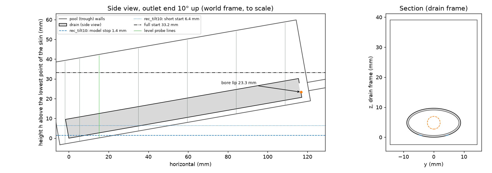

# VOF check of the stop levels (OpenFOAM interFoam on ETH Euler)

The reduced-order model in `drainstop/` predicts the pool level at which the drain stops draining. This folder holds a 3D two-phase volume-of-fluid check of two of those predictions. Both cases have the outlet end tilted 10° up:

| Case | Layout | Model stop level | Model: Q_L < 10 mL/min at | Gas pressure in the drain at stop |
|---|---|---|---|---|
| `usz_tilt10` | as-built USZ field, `usz_as_built()`: 318 × Ø1.0 through both faces, 609 openings | **20.0 mm** | 20.04 mm | −37 Pa |
| `rec_tilt10` | recommended, `results/recommended.json`: 2 rows at ±30°, staggered, 36 × Ø1.0 | **1.4 mm** (1.36) | 1.59 mm | −407 Pa |

Levels are pool levels h above the lowest point of the skin, as in the paper. The bore lip is at 23.3 mm. For the USZ field the model says the drain stalls 3.3 mm below the lip: air leaking in through the exposed openings leaves only enough vacuum to lift the liquid that far. For the recommended layout it keeps about 400 Pa of vacuum and drains until its lowest openings are uncovered.

**Status:** the cases, mesh set-up and job scripts are ready, but none of it has been run. This machine has no OpenFOAM. The drain surfaces and the post-processing were tested here (see "What was checked here"). The OpenFOAM dictionaries are written for v2306 (ESI) but have not been through a solver. `vof/hpc/test_vof.sbatch` is the first real test.



## 1. What is modelled

**Frame.** The mesh is built in the drain frame: x runs along the drain from the tip, z is up when the drain lies flat, and the origin is the bottom of the tip. The 10° tilt enters only through gravity, `g = (−9.81 sin 10°, 0, −9.81 cos 10°)`. The mesh therefore stays aligned with the drain, and the pool's free surface is tilted relative to the mesh. In mesh coordinates, the world height is

    h = x sin 10° + z cos 10°        (mm; ParaView Calculator: 1000*(coordsX*0.173648+coordsZ*0.984808))

and h is the model's pool level.

**Drain** (`constant/triSurface/drain.stl`, generated with numpy from `Drain` in `model.py`):
- Elliptic skin, 17.85 × 9.67 mm outside, 119 mm long. The wall is the 0.6 mm normal offset of the outer ellipse.
- Closed tip, and an end face with the Ø4.24 mm bore, centred.
- A straight outlet tube, Ø4.24 mm inside with a 0.8 mm wall, 16.8 mm (about 4 bore diameters) beyond the end face.
- Every opening of the model's pattern is drilled as a cylinder along the skin normal at its centre (x, θ), with the opening's area.
- One closed surface: 229 k triangles for USZ, 165 k for the recommended layout.

**Pool.** A trough around the drain:
- 5.5 mm beside it, 5 mm beyond the tip, 4 mm beyond the end face (a wall that the tube passes through).
- A floor 2.5 mm below the bottom line, parallel to the drain.
- The top of the domain is open to the atmosphere (`atmosphere`: total pressure 0 gauge) and always stays in air.

The pool footprint is kept small to keep both the mesh and the drained volume small.

**Physics.**
- interFoam, laminar.
- 50 wt% glycerol-water: ρ 1126 kg/m³, μ 6 mPa·s, γ 0.068 N/m.
- Air: ρ 1.204 kg/m³, μ 18.1 µPa·s. Both phases are incompressible.
- Contact angle 90° on all walls, as θ_e = 90° in the model's base case (no capillary hold).
- `outlet`: fixed static pressure −933.25 Pa (−7 mmHg) at the end of the tube (`prghPressure`). This is an ideal regulator with unlimited flow. It matches the wall regulator chosen as the suction source, and the model's default (`Suction.q_max = inf`).

**Start.** Liquid fills everything below a horizontal level h0, inside and outside the drain, at rest. The suction acts from t = 0.

| Start | h0 | Why |
|---|---|---|
| `full` | 33.19 mm, 3 mm above the drain's highest point | the requested case; the drain starts fully submerged and full |
| `short` | model stop + 5 mm: 24.97 mm (USZ), 6.36 mm (rec) | about a third cheaper for the recommended layout, less for USZ; drain interior at pool level, air above it |

With θ_e = 90° the model has no hysteresis, so both starts should end at the same level. If they don't, that difference is itself a result.

**Mesh** (blockMesh 1.6 mm, then snappyHexMesh; no layers):

| Region | coarse | fine |
|---|---|---|
| air far from the drain | 1.6 mm | 1.6 mm |
| pool below the start level | 0.8 mm | 0.8 mm |
| drain interior, outlet tube, skin | 0.4 mm | 0.4 / 0.2 mm (skin) |
| openings (≥ 5 cells across Ø1.0), tip cap, end face, bore and lip | 0.2 mm | 0.1 mm |
| estimated cells, USZ / recommended | 1.34 M / 0.78 M | 4.4 M / 2.7 M |

**Monitors** (written by interFoam, read by `watch_run.py` and `analyse_run.py`):
- `liquidVolume`, `lumenVolume`: liquid volume in the whole domain and in the cellZone `lumen` (drain interior + tube, made by `topoSet`). The pool holds the difference.
- `outletFlow`, `outletLiquid`: total and liquid flow at the outlet.
- `tubeSection`: area-averaged static pressure and liquid fraction across the tube, 2 bore diameters downstream of the bore entrance.
- `levelProbes`: liquid fraction on 13 world-vertical lines in the pool (1365 points, 0.4 mm apart).
- `lumenProbes`: pressure and liquid fraction at the top of the drain interior (5 points) and at the bore entrance.
- `freeSurface`: the α = 0.5 surface as VTK every 0.05 s, for ParaView.

**Differences from the model's geometry**, all small and deliberate:
- The 27 USZ half-moon notches at the side edges (counted as half openings in the model) are Ø0.71 mm round openings of equal area at θ = ±90°.
- The tip cap is 0.3 mm and the end face 0.4 mm thick. USZ openings come within 0.4 mm of the tip and 0.6 mm of the end face, so thicker walls would cut into them.
- The suction is fixed at the end of a 4-diameter tube, not exactly "just downstream of the bore entrance". At the stop only air flows in the tube. Its friction over 2 diameters is roughly 50 Pa (5 %), which changes the USZ lift of 3.3 mm by about 0.15 mm. `tubeSection` records the pressure that actually acts.
- The pool has walls and a floor; the model's pool is unbounded. Near the stop the flows are small, so the walls hardly matter there.

## 2. Files

| Path | What it is |
|---|---|
| `make_cases.py` | Generator. Builds the drain surfaces as STL (numpy; Delaunay from SciPy or matplotlib), the cases, `runtime_estimate.md` and `domain.png`. Run `py -3.12 vof/make_cases.py` (about 1 min) or with `--no-estimate` (10 s). |
| `cases/usz_tilt10/`, `cases/rec_tilt10/` | Case templates: `constant/` (g, transportProperties, STL), `0.orig/`, `system/` (blockMesh, `snappyHexMeshDict.coarse/.fine`, `setFieldsDict.full/.short`, topoSet, interFoam), `Allmesh`, `case.json` (geometry, predictions, probe lines, pool volume table), `case.env`. The STL files are built by `make_cases.py` and not kept in git. |
| `.gitignore` | Keeps the STL files and any outputs of a case meshed or run in place out of git |
| `hpc/env_euler.sh` | Modules (same stack as `drainsponge/hpc/env_euler.sh`: OpenFOAM v2306) and the Python venv |
| `hpc/test_vof.sbatch` | Set-up check and timing: mesh + 20 ms of interFoam (≈ 1–1.5 h) |
| `hpc/run_vof.sbatch` | One run: mesh, interFoam, stop test, chaining over 24 h jobs, analysis |
| `hpc/watch_run.py` | Runs next to interFoam: stops it cleanly when the pool has stopped draining, or before the job's time limit |
| `hpc/archive_vof.sh` | Copies a run's results from `$SCRATCH` to `$HOME` |
| `analyse_run.py` | Pool level, flows, stop level and gas pressure, next to the model. `--timing` gives cost per step and a projected wall time. |
| `runtime_estimate.md` / `.json` | Estimated cells, physical time, steps and wall time for every case × start × mesh × air density |

## 3. Running on Euler

The rules for using Euler (who may use it, login nodes, scratch purge) are in `drain/drainsponge/hpc/README_EULER.md`, section 0. They apply here too.

### One-time set-up (≈ 10 min)

```bash
ssh <ethz-user>@euler.ethz.ch
git clone https://github.com/IasonKa/drain.git && cd drain/drainstop
source vof/hpc/env_euler.sh
python -m venv $HOME/venvs/drainstop && $HOME/venvs/drainstop/bin/pip install numpy matplotlib
source $HOME/venvs/drainstop/bin/activate
python vof/make_cases.py --no-estimate      # builds the STL surfaces of both cases, ~10 s
mkdir -p logs
```

All commands below are run from `drain/drainstop`.

The STL surfaces (about 20 MB) are not in git (`vof/.gitignore`); the rest of each case template is. `make_cases.py` rebuilds the surfaces from the analytic geometry. It uses `scipy.spatial.Delaunay` when SciPy is installed and matplotlib otherwise, so the triangles can differ slightly between the two, but not the shape. `run_vof.sbatch` and `test_vof.sbatch` also rebuild a missing case themselves. Still, building them once on the login node, as above, avoids two jobs rebuilding the same case at once.

### Test and timing (≈ 1–1.5 h per case)

```bash
sbatch vof/hpc/test_vof.sbatch               # rec_tilt10
sbatch vof/hpc/test_vof.sbatch usz_tilt10    # optional: the USZ mesh (1.3 M cells) and its timing
```

Check `logs/drainstop-vof-test_<id>.out`:
- **Mesh:** `cells:` from `checkMesh`, `Mesh OK`, a non-empty `outlet` patch (Allmesh stops if the drain interior got cut off from the pool), and the `lumen` zone in the topoSet output.
- **interFoam:** must reach t = 0.02 s with exit code 0.
- **Timing:** the last lines (`analyse_run.py --timing`) give seconds per step, the time step, the cost in µs per cell, step and core (the estimate assumes 10), and a projected wall time to the model's stop level. Rescale the table in section 5 with it.

Then check the real usage with `myjobs -j <id>`, and adjust `--ntasks` and `--mem-per-cpu` if needed. Below about 15 k cells per core, more cores stop helping.

### Production runs

```bash
sbatch vof/hpc/run_vof.sbatch usz_tilt10                # full start, coarse, real air
sbatch vof/hpc/run_vof.sbatch rec_tilt10
```

Options are positional (`<case> [full|short] [coarse|fine]`), plus one environment variable:

```bash
sbatch vof/hpc/run_vof.sbatch rec_tilt10 short                 # short start
sbatch vof/hpc/run_vof.sbatch rec_tilt10 short fine            # fine mesh
AIR_RHO_FACTOR=10 sbatch vof/hpc/run_vof.sbatch usz_tilt10     # 10x denser air, about 3x fewer steps
```

Each run lives in `$SCRATCH/drainstop_vof/<case>_<start>_<res>[_air<f>]`. The first job meshes it, which takes about 10–40 min on 48 cores. Then:
- **Stop test.** `watch_run.py` checks the pool's liquid volume every minute. Once the pool has lost liquid slower than 10 mL/min over the last 0.3 s of simulated time, it writes `STOPPED` and sets `stopAt writeNow`. The job then reconstructs the last time and writes `analysis/`.
- **Chaining.** About 30 min before the 24 h limit, it writes `WALLTIME` and stops interFoam the same way. The job then resubmits itself, at most `MAX_CHAIN` = 12 times. The next job continues from the latest written time.
- **Restarts.** `scancel` is safe: rerun the same `sbatch` line to continue. At most the last 0.1 s of simulated time is lost.
- **Time limit.** `endTime` is twice the model's time to stop, as an upper bound. If it is reached first, the run writes `FINISHED` instead of `STOPPED`.

Watching a run:

```bash
tail -f $SCRATCH/drainstop_vof/usz_tilt10_full_coarse/watch.log    # wall s, simulated s, pool level (mm), drain rate (mL/min)
python vof/analyse_run.py $SCRATCH/drainstop_vof/usz_tilt10_full_coarse --timing
python vof/analyse_run.py $SCRATCH/drainstop_vof/usz_tilt10_full_coarse --plot    # works on a running case too
squeue -u $USER ; myjobs -j <jobid>
```

**Storage.** One run writes the fields every 0.1 s (0.05 s for the short start). Each write is about 0.1 GB for 1.3 M cells, so a full run comes to about 10–15 GB and 20–40 k files on `$SCRATCH` (the limit is 1 M files). Archive the results before scratch is purged:

```bash
bash vof/hpc/archive_vof.sh $SCRATCH/drainstop_vof/usz_tilt10_full_coarse    # -> $HOME/drainstop_vof_results/*.tar.gz
```

The archive holds the monitors, logs, analysis and the last time step, but not the decomposed fields.

### If something fails

- **`interFoam not found`, or a module fails to load:** edit `vof/hpc/env_euler.sh` (`module avail openfoam`).
- **snappyHexMesh:**
  - Problems at the thin tip cap or end face (quality errors, or a leak between pool and drain interior): raise the `tipZone`/`endZone` level by one in `system/snappyHexMeshDict.<res>` of the case template.
  - `outlet patch has no faces`: the openings were not resolved, so the drain interior was cut off.
  - `log.snappyHexMesh` and `log.checkMesh` are in the run directory.
- **topoSet does not find `lumen`:** set `useSurfaceOrientation false;` in `system/topoSetDict`. It then uses `outsidePoints` instead.
- **interFoam blows up:** this usually shows as Courant spikes in the air jet through the bore. Lower `maxCo` and `maxAlphaCo` to 0.5 in the run's `system/controlDict`. It is re-read while running, but it doubles the cost.
- **`STOPPED` early, or never:** the watch line `pool_drain_ml_min` shows what the test sees. The threshold (`q_stop_ml_min`) and window (`stop_window_s`) are in the run's `case.json`.

## 4. Reading the result and comparing it with the predictions

`analysis/summary.txt` (written at the end of every run, or on demand with `analyse_run.py <run>`) looks like this:

```
                                                 model       VOF
stop level, Q < 10 mL/min (mm)                   20.04     ...     (probe lines: ...)
stop level, Q -> 0 (mm)                          19.97     ...     (line through Q(h) for h = ...)
pool level at the end of the run (mm)                      ...     (probe lines: ...)
pool drain rate at the end (mL/min)                        ...
gas pressure in the drain at the end (Pa)          -37     ...
static pressure in the tube, 2 bore d (Pa)        -933     ...
```

`analysis/summary.png` plots the level against time, and the drain rate and gas pressure against level, each with the model's curve. `analysis/series.csv` holds the time series.

**The final pool level.** It is read from the pool's liquid volume: all liquid minus the liquid in the drain and tube. The pool's volume table V(h), computed from the trough and drain geometry and stored in `case.json`, turns that volume into a level (`h_vol`). Because it is an integral, waves, sloshing and the local draw-down around the drain do not affect it. Compare this number with the model's.

The probe lines give the local level (`h_probe`, the median of the wet lines; `summary.png` shows each line). It should agree with `h_vol` to within a few tenths of a millimetre once the pool is at rest. The spread between lines shows the draw-down next to the drain.

**Which numbers to compare:**
- **Stop level at Q < 10 mL/min.** This is the level at which the run's stop test fired, against the model's level at the same threshold (20.04 / 1.59 mm). This is the cleanest comparison: same definition on both sides.
- **Stop level at Q → 0.** A straight line through the late part of the CFD drain rate Q(h) (10–300 mL/min), extrapolated to zero, against the model's `h_stop` (19.97 / 1.36 mm). Near the stop the model's Q(h) is close to linear. This number is also available while the run is still going: once it settles, you can end the run with `scancel` without waiting for the slow final approach.
- **Gas pressure in the drain.** This is the mechanism behind the stop, so it is the second check: about −37 Pa (USZ) and −407 Pa (recommended) at the stop. The tube-section pressure shows how much suction actually reaches the bore.

**What agreement to expect.** On the coarse mesh, a difference below about 0.5 mm means the model is confirmed. Larger differences point at things the model leaves out:
- **USZ: VOF stops clearly lower than 20 mm.** The air jet through the bore drags liquid over the lip (entrainment, or slugs). The model only lets liquid leave below the inner level.
- **USZ: VOF stops higher.** There is less lift than modelled. Air bubbling in through openings that sit below the inner liquid level costs more pressure than the model's weighting Λ_w allows.
- **Recommended layout: VOF stops higher than 1.4 mm.** The surface dips into the lowest openings and they suck air before they are uncovered (the model's κ = 0). The paper's κ sensitivity covers this.
- **Full and short starts disagree.** There is hysteresis that the θ_e = 90° model does not have.

Mesh dependence: run the fine mesh for the recommended layout from the short start. With real air it is too expensive (section 5), so use `AIR_RHO_FACTOR=10` and compare against the coarse run with the same factor.

## 5. Run-time estimate (coarse mesh)

From `runtime_estimate.md`. The estimate assumes 48 cores, 10 µs per cell, step and core, and 80 % parallel efficiency. **Calibrate it with the test job.**

| Case | Start | Air density | Cells | Physical time | Time step once air is in | Steps | Wall time | Core-hours |
|---|---|---|---|---|---|---|---|---|
| usz_tilt10 | full (33.2 mm) | ×1 | 1.34 M | 7.4 s | 5.2 µs | 1.30 M | **5.3 days** | 6,100 |
| usz_tilt10 | full | ×10 | 1.34 M | 7.4 s | 16 µs | 0.42 M | 1.7 days | 2,000 |
| usz_tilt10 | short (25.0 mm) | ×1 | 1.34 M | 5.6 s | 5.2 µs | 1.09 M | 4.4 days | 5,100 |
| usz_tilt10 | short | ×10 | 1.34 M | 5.6 s | 16 µs | 0.34 M | 1.4 days | 1,600 |
| rec_tilt10 | full (33.2 mm) | ×1 | 0.78 M | 13.4 s | 6.8 µs | 1.48 M | **3.5 days** | 4,000 |
| rec_tilt10 | full | ×10 | 0.78 M | 13.4 s | 22 µs | 0.52 M | 1.2 days | 1,400 |
| rec_tilt10 | short (6.4 mm) | ×1 | 0.78 M | 5.8 s | 6.8 µs | 0.85 M | 2.0 days | 2,300 |
| rec_tilt10 | short | ×10 | 0.78 M | 5.8 s | 22 µs | 0.27 M | 0.6 days | 700 |

Where the cost comes from:
- **Air in the bore sets the time step.** Once air reaches the bore, it jets through at √(2 Δp / ρ_air) ≈ 30–40 m/s. On 0.2 mm cells at Courant number 1, that limits the step to about 5 µs. While the drain is still full of liquid, the step is about 50 µs, limited by the capillary time-step limit, so that phase costs little.
- **The approach to the stop is slow.** Near the stop Q falls linearly with the level, so the pool approaches the stop level exponentially, with a time constant A_fs/(dQ/dh) of about 1 s. The last 2 mm above the stop take about 4 s in both cases: 56 % of the USZ run and 27 % of the recommended one. That is why the short start saves less than it seems. The Q → 0 extrapolation lets you end a run earlier.
- **Denser air (`AIR_RHO_FACTOR=10`, ρ = 12 kg/m³) is a valid shortcut for the stop level.** The exposed openings and the bore are two orifices in series. Both pressure drops scale with ρ_air, so the vacuum left in the drain, and with it the stop level, does not depend on ρ_air. The viscous part of the opening resistance falls from about 3 % to 1 %, and the weight of the air column grows to about 5 Pa. Together they move the vacuum by about 1 %, or a few hundredths of a millimetre of lift. The air velocities drop by √10, so the time step grows about 3×. It changes the dynamics (jets, entrainment), so it is not a substitute for the real-air run when entrainment matters.
- **The fine mesh** halves the cell size at the openings and bore. That gives about 3× the cells and 2× the steps: 24–35 days with real air, 9–11 days with ×10 for the full start. The README therefore suggests it only as a mesh check for the recommended layout from the short start with ×10 (≈ 4 days).

A suggested order, about 5–6 days of wall time in parallel:
1. `test_vof` for both cases.
2. `AIR_RHO_FACTOR=10` full-start runs of both cases (1.2–1.7 days). They give the comparison quickly.
3. The real-air full-start runs (3.5 and 5.3 days), submitted at the same time.

## 6. What was checked here (without OpenFOAM)

- **Drain surfaces.**
  - Closed, consistently oriented, with Euler characteristic 2 − 2N (N = 609 and 36 openings, one handle each).
  - The solid volume equals envelope − interior + tube − openings to within 0.1 %.
  - Close-up renders of the openings, the tip, the end face with the bore, and the tube looked right.
- **Pool volume table and start levels.** Consistent with the model: start 33.19 mm, lip 23.34 mm, stop levels 19.97 / 1.36 mm.
- **`watch_run.py` and `analyse_run.py`.** Tested on synthetic run directories in the interFoam output formats, built from the model's own drainage curve, with a restart split in the monitors. The volume-based and probe-based levels agree, and the stop test fires at the expected level.
- **Not checked:**
  - The OpenFOAM dictionaries in a real OpenFOAM: syntax for v2306, snappyHexMesh behaviour at the 0.3–0.4 mm caps, and interFoam stability in the bore jet.
  - Module names on Euler, and the cost per step.

  These are what the test job is for.
