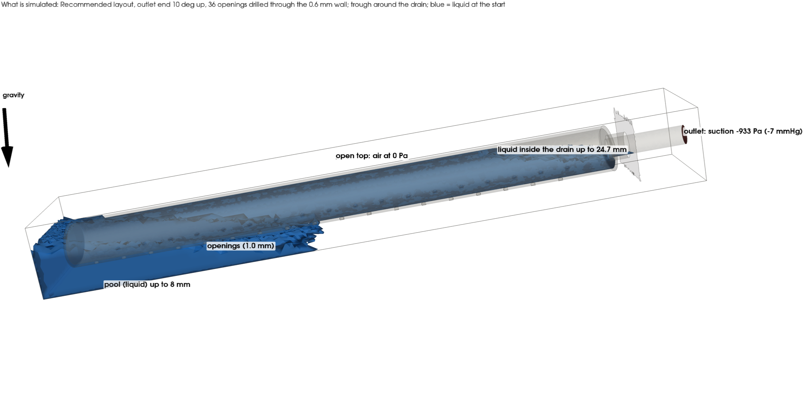
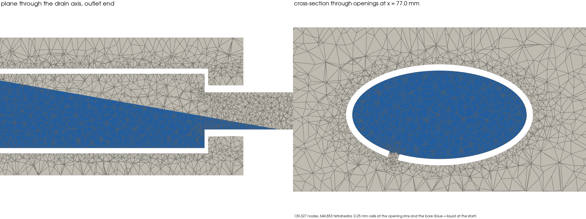

# 3D two-phase CFD of the drain with Kratos Multiphysics (Windows workstation)

This folder runs a 3D CFD check of the drain-stop study (`drainstop/paper/drain_stop.pdf`) on an ordinary Windows 10/11 PC or workstation. It uses [Kratos Multiphysics](https://github.com/KratosMultiphysics/Kratos) (two-fluid Navier–Stokes, level set) and [gmsh](https://gmsh.info). Everything installs with two double-clicks; no Linux, WSL, MPI or compiler is needed.



## What is simulated

| Item | Set-up |
|---|---|
| Drain | USZ size: elliptic skin 17.85 × 9.67 mm, 119 mm long, 0.6 mm wall, closed tip, Ø4.24 mm bore in the end face, 16.8 mm outlet tube. Every opening of the layout is drilled through the wall along the skin normal. |
| Cases | `rec_tilt10`: the recommended layout (2 staggered rows at ±30°, 36 × Ø1.0 mm), pool at 8 mm. `usz_tilt10`: the as-built USZ field (609 openings), pool at 21 mm, 1 mm above the stop level the model predicts. Both have the outlet end 10° up. |
| Pool | A trough 5.5 mm wider than the drain on each side, with a floor parallel to the drain. Liquid fills it up to the pool level; the top is open to the air (0 Pa). |
| Suction | The pressure at the end of the outlet tube is held at −933 Pa (−7 mmHg), an ideal wall regulator. |
| Fluids | 50 wt% glycerol–water (1126 kg/m³, 6 mPa·s) and air (1.204 kg/m³, 0.018 mPa·s), both incompressible. Surface tension is not modelled, as in the paper's base case (contact angle 90°). |
| Start | Pool liquid below the pool level. Inside the drain, liquid fills up to the level the model predicts for that pool level, with air above it. |
| Output | Liquid and air flow out of the tube, the pressure inside the drain, the flow through every opening, and the full liquid/air, pressure and velocity fields, all compared with the model. |

**Air.** Air is fully simulated. Kratos solves one set of flow equations for liquid and air together, and a level-set field marks where the liquid is. Air enters through the exposed openings from the open top of the trough and leaves through the bore with the liquid. That air leak is what makes the drain stop, so it can't be left out.

**Mesh.** The tetrahedral mesh comes from gmsh:

| Region | Cell size |
|---|---|
| Opening rims and the bore | 0.25 mm (USZ coarse preset: 0.35 mm) |
| Skin | 0.5 mm (0.6 mm) |
| Inside the drain | 0.8 mm |
| Pool and air | 1.6 mm |



## Quick start on a new Windows workstation

1. **Get the files:** on https://github.com/IasonKa/drain, choose **Code → Download ZIP**. Before unzipping, right-click the ZIP → Properties → tick **Unblock**, so Windows doesn't block the scripts. Then extract it, for example to `C:\drain`. With git installed, `git clone https://github.com/IasonKa/drain.git` works too.
2. **Install everything, once:** double-click `drainstop\vof\kratos\SETUP.bat`. It installs:
   - the Microsoft Visual C++ runtime, which Kratos needs. Windows asks for administrator approval once, and only if it's missing.
   - Python 3.12 for your user, with no admin rights needed.
   - a Python environment in `%USERPROFILE%\venvs\drain-kratos` with Kratos, gmsh and pyvista (about 0.7 GB).

   At the end it checks that Kratos loads and prints the number of CPU threads.
3. **Run:** double-click `drainstop\vof\kratos\RUN.bat`. For each case it:
   - builds the geometry and the mesh;
   - runs Kratos on all physical CPU cores, showing progress every 10 steps;
   - makes the pictures in `drainstop\vof\kratos\results\<case>\`.

   Keep the PC plugged in. The runner stops Windows from idle-sleeping while it works, but closing a laptop lid still sleeps it.
4. **Share:** commit and push `drainstop\vof\kratos\results\`, or just send that folder.

Options, from a command prompt in `drainstop\vof\kratos`:

```
RUN.bat -Cases rec_tilt10:8                    one case only
RUN.bat -Cases rec_tilt10:8,rec_tilt10:2       other pool levels (mm)
RUN.bat -Threads 16                            limit the CPU threads
RUN.bat -FineUSZ                               USZ with 0.25 mm opening cells (about 1.7x the cost)
RUN.bat -Force                                 run a finished case again
```

**Stopping and continuing.** You can stop a run at any time: close the window, reboot, or let the PC lose power. Running `RUN.bat` again continues it from its last snapshot, saved every 5 ms of flow, so you lose at most about 5 ms of flow. Finished cases are skipped, and `-Force` starts a case from zero.

## GPU: not used, and why

Kratos's Windows build runs its solver on CPU threads (OpenMP). It has no GPU support: its AMGCL linear solver would need Kratos to be compiled with VexCL/OpenCL, and the published Windows packages aren't. A "use GPU" request is silently ignored. There's also no ready AMD-GPU path for this kind of two-phase (liquid + air) CFD on Windows in OpenFOAM or other open-source codes; their GPU solvers are mostly CUDA-only (NVIDIA) and Linux-only.

So the **CPU cores** set the speed. The AMD GPU is used only to draw the 3D pictures (pyvista/OpenGL). On a workstation:
- more physical cores help, up to about 32;
- `RUN.bat -Threads N` with N equal to the physical core count is usually best.

## Run times

Both cases are fixed-level snapshots: they run for 0.10 s (recommended layout) or 0.06 s (USZ) of flow, at a fixed time step of 50 µs.

| Machine | Recommended (139 k nodes, 2,000 steps) | USZ coarse (203 k nodes, 1,200 steps) |
|---|---|---|
| 12-core laptop CPU (Intel Core Ultra 7 255U), measured | about 25–35 s/step → 15–20 h | about 40–50 s/step → 13–17 h |
| 16–32-core workstation, estimate | about 8–15 s/step → 5–8 h | about 12–20 s/step → 4–7 h |

Meshing takes about 1 min for the recommended case and about 15 min for the USZ case, which has 609 openings. Disk use is about 0.5–1 GB per case, in `runs\`, which isn't kept in git.

## Settings, and why

| Setting | Value | Reason |
|---|---|---|
| Time step | fixed 50 µs, BDF2 implicit | The air jets through the openings (20–35 m/s) would force steps of about 10 µs with an automatic Courant number. The implicit solver is stable at 50 µs, and the liquid surface moves less than a cell per step. What's compared with the model is the settled flow, not the start-up. |
| `acceleration_limitation` | off | Kratos caps every acceleration at 5 g by default. Air jets accelerate about 10⁵ m/s², so with the cap on, the flow barely starts. |
| Level-set sub-steps | at most 4 | Unlimited sub-stepping follows the fast air jets far from the liquid surface and more than doubles the cost. Near the liquid surface the flow is slow. |
| Linear solver | AMGCL, ILU0 / LGMRES, tolerance 1e-6, 3 non-linear iterations | The liquid is 1000 times denser than the air, which makes the systems stiff. This combination converges in 2–3 iterations. |
| USZ end openings | moved 0.15–0.25 mm inward | Otherwise they leave 0.1–0.2 mm wall slivers at the tip cap and the end face that no tetrahedral mesh can fill. |

## Files

| File | What it does |
|---|---|
| `SETUP.bat`, `setup_windows.ps1` | One-time installation (see Quick start) |
| `RUN.bat`, `run_all.ps1` | Mesh, run and make the pictures for the cases |
| `make_case.py` | Geometry (gmsh/OpenCASCADE), tetrahedral mesh, Kratos model file `drain.mdpa`, materials, `ProjectParameters.json`, the model's prediction (`model_state.json`) |
| `run_case.py` | Runs Kratos and logs the outlet flows and probe pressures every step (`monitor.csv`) |
| `render_kratos.py` | Pictures and `summary.json` from the results |
| `show_setup.py` | Pictures of the geometry, boundary conditions, start and mesh |
| `requirements-windows.txt` | Exact Python package versions |

**Pictures per case** in `results\<case>\`:

| File | What it shows |
|---|---|
| `setup_3d.png`, `setup_mesh.png` | What is simulated |
| `midplane.png` | Liquid/air, pressure and velocity on the cut through the drain axis, tilted as in the pool |
| `outlet_end.png` | The outlet end, with streamlines |
| `row.png` | The cut through a row of openings |
| `sections.png` | Cross-sections through a submerged and an exposed opening |
| `openings.png` | Flow through every opening on the unrolled skin, CFD next to the model |
| `view3d.png` | 3D: pressure on the drain, the liquid surface, and the flow through each opening |
| `history.png` | Outlet liquid and air flow and the pressure inside the drain against time, with the model's values |
| `midplane.gif` | The mid-plane over time |
| `midplane_slow.gif`, `outlet_end_slow.gif` | Slow animations, 1.5 s per 5 ms of flow, with the time and the measured flows in each title (`make_gifs.py`) |
| `cut3d_<t>ms.png`, `cut3d_slow.gif`, `cut3d_orbit.gif` | 3D view of the drain cut open along its axis: wall and cut plane coloured by pressure, liquid surfaces and bubbles, streamlines coloured by speed; over time, and with the camera swinging around the last output (`render_3d.py`) |
| `summary.json`, `monitor.csv` | The numbers |

## Troubleshooting

- **"Windows protected your PC" when starting a .bat:** choose **More info → Run anyway**, or unblock the ZIP before extracting (step 1).
- **`SETUP.bat` fails at pip:** check the internet connection or proxy, then run it again. It continues where it stopped.
- **Kratos does not load / missing `MSVCP140.dll` or `VCOMP140.dll`:** the Visual C++ runtime didn't install. Install it from https://aka.ms/vs/17/release/vc_redist.x64.exe and run `SETUP.bat` again.
- **Very slow or uneven steps:** other heavy programs are running, or the PC throttles on battery. Keep it plugged in and use `-Threads` equal to the physical core count.
